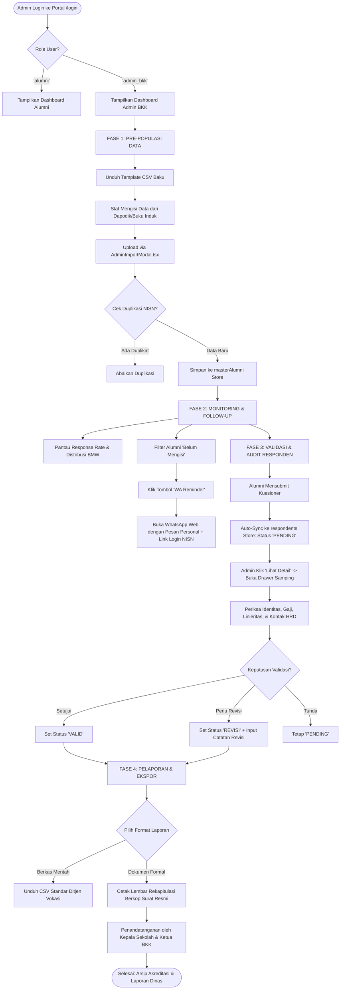
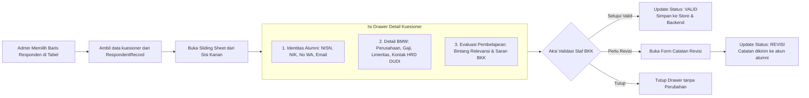

# Workflow & Dokumentasi Teknis: Panel Administrator BKK
## Sistem Informasi Alumni & Tracer Study SMK Sasmita Jaya 2

Dokumen ini menjelaskan secara komprehensif alur kerja (*workflow*), arsitektur komponen, struktur data, diagram alir (*flowcharts*), serta prosedur operasional standar (SOP) dari modul **Dashboard Administrator BKK (Bursa Kerja Khusus)** pada sistem Tracer Study SMK Sasmita Jaya 2 Pamulang.

---

## 1. Ringkasan Eksekutif & Struktur Berkas

Panel Administrator BKK dirancang untuk kebutuhan pemantauan skala besar, validasi data responden kuesioner, tindak lanjut pengisian alumni, publikasi lowongan kerja serta berita sekolah, penanganan aduan/pesan alumni, dan pelaporan resmi keterserapan lulusan (BMW: Bekerja, Melanjutkan Pendidikan, Wirausaha) ke pihak Yayasan Sasmita Jaya, Dinas Pendidikan, serta Direktorat Jenderal Pendidikan Vokasi Kemendikbudristek RI.

```
┌─────────────────────────────────────────────────────────────────────────────────────────┐
│                           PANEL ADMINISTRATOR BKK                                       │
├───────────────────┬───────────────────┬───────────────────┬─────────────────────────────┤
│ 1. Monitoring     │ 2. Master Data    │ 3. Verifikasi     │ 4. Pelaporan Resmi          │
│ • Response Rate   │ • Import Dapodik  │ • Audit Jawaban   │ • Export Ditjen Vokasi      │
│ • Target Kuota    │ • Pre-populate    │ • Detail Drawer   │ • Cetak Rekap PDF (Kop SK)  │
│ • Distribusi BMW  │ • WA Blast / Rem. │ • Validasi Status │ • Tanda Tangan Kepsek & BKK │
├───────────────────┼───────────────────┼───────────────────┼─────────────────────────────┤
│ 5. Pesan Masuk    │ 6. Kelola Berita  │ 7. Kelola Loker   │ 8. Pengaturan Sistem        │
│ • Helpdesk Tiket  │ • Editor Artikel  │ • Kurasi DUDI     │ • Kuota Target Angkatan     │
│ • Pesan Kontak    │ • Publikasi Info  │ • Direct Referral │ • Nama Pejabat Penandatangan│
└───────────────────┴───────────────────┴───────────────────┴─────────────────────────────┘
```

### 1.1 Berkas Sumber Kode Terkait (File Structure)

| Modul / Komponen | Path Berkas | Fungsi Utama |
| :--- | :--- | :--- |
| **State Management Admin** | [`src/store/adminStore.ts`](file:///c:/Arif/projek%20coding/web_alumni/src/store/adminStore.ts) | Store Zustand master data alumni, responden, dan pengaturan sekolah |
| **State Management Konten** | [`src/store/contentStore.ts`](file:///c:/Arif/projek%20coding/web_alumni/src/store/contentStore.ts) | Store Zustand publikasi lowongan kerja dan artikel berita BKK |
| **State Management Pesan** | [`src/store/mailStore.ts`](file:///c:/Arif/projek%20coding/web_alumni/src/store/mailStore.ts) | Store Zustand pesan masuk, tiket bantuan, dan riwayat pesan |
| **Routing & Aliases** | [`src/App.tsx`](file:///c:/Arif/projek%20coding/web_alumni/src/App.tsx) | Rute `/admin/*` dan pengalihan ke `/dashboard?tab=...` |
| **Shell Layout** | [`src/components/dashboard/DashboardLayout.tsx`](file:///c:/Arif/projek%20coding/web_alumni/src/components/dashboard/DashboardLayout.tsx) | Orchestrator tab admin & switch role dinamis |
| **Sidebar Navigasi** | [`src/components/dashboard/DashboardSidebar.tsx`](file:///c:/Arif/projek%20coding/web_alumni/src/components/dashboard/DashboardSidebar.tsx) | Menu navigasi khusus admin dengan 8 menu aktif |
| **Header / Topbar** | [`src/components/dashboard/DashboardHeader.tsx`](file:///c:/Arif/projek%20coding/web_alumni/src/components/dashboard/DashboardHeader.tsx) | Status profil admin, badge BKK, dan menu notifikasi |
| **Tab 1: Dashboard Overview** | [`src/components/dashboard/admin/AdminOverviewTab.tsx`](file:///c:/Arif/projek%20coding/web_alumni/src/components/dashboard/admin/AdminOverviewTab.tsx) | Quick stats cards, KPI keterserapan, metrik 6 jurusan |
| **Tab 2: Data Alumni** | [`src/components/dashboard/admin/AdminMasterAlumniTab.tsx`](file:///c:/Arif/projek%20coding/web_alumni/src/components/dashboard/admin/AdminMasterAlumniTab.tsx) | Master siswa lulusan & tombol WhatsApp Reminder |
| **Modal Import CSV** | [`src/components/dashboard/admin/AdminImportModal.tsx`](file:///c:/Arif/projek%20coding/web_alumni/src/components/dashboard/admin/AdminImportModal.tsx) | Drag-and-drop parser CSV/Excel & template downloader |
| **Tab 3: Data Responden** | [`src/components/dashboard/admin/AdminRespondentsTab.tsx`](file:///c:/Arif/projek%20coding/web_alumni/src/components/dashboard/admin/AdminRespondentsTab.tsx) | Data table kuesioner masuk dengan multi-filter status |
| **Drawer Audit Form** | [`src/components/dashboard/admin/AdminRespondentDetailDrawer.tsx`](file:///c:/Arif/projek%20coding/web_alumni/src/components/dashboard/admin/AdminRespondentDetailDrawer.tsx) | Sliding sheet detail kuesioner & aksi verifikasi |
| **Tab 4: Pesan Masuk** | [`src/components/dashboard/admin/AdminMessagesTab.tsx`](file:///c:/Arif/projek%20coding/web_alumni/src/components/dashboard/admin/AdminMessagesTab.tsx) | Manajemen kotak masuk tiket alumni & saluran bantuan |
| **Modal Detail Pesan** | [`src/components/dashboard/admin/AdminMessageDetailModal.tsx`](file:///c:/Arif/projek%20coding/web_alumni/src/components/dashboard/admin/AdminMessageDetailModal.tsx) | Dialog pembacaan pesan dan penandaan status selesai |
| **Tab 5: Kelola Berita** | [`src/components/dashboard/admin/AdminNewsTab.tsx`](file:///c:/Arif/projek%20coding/web_alumni/src/components/dashboard/admin/AdminNewsTab.tsx) | Manajemen publikasi berita, artikel BKK, dan agenda |
| **Editor Berita** | [`src/components/dashboard/admin/AdminNewsEditor.tsx`](file:///c:/Arif/projek%20coding/web_alumni/src/components/dashboard/admin/AdminNewsEditor.tsx) | Form pembuatan dan penyuntingan konten berita |
| **Tab 6: Kelola Loker** | [`src/components/dashboard/admin/AdminJobsTab.tsx`](file:///c:/Arif/projek%20coding/web_alumni/src/components/dashboard/admin/AdminJobsTab.tsx) | Manajemen katalog lowongan kerja dan kemitraan DUDI |
| **Editor Loker** | [`src/components/dashboard/admin/AdminJobEditor.tsx`](file:///c:/Arif/projek%20coding/web_alumni/src/components/dashboard/admin/AdminJobEditor.tsx) | Form kurasi lowongan kerja mitra dan kanal rujukan |
| **Tab 7: Laporan & Ekspor** | [`src/components/dashboard/admin/AdminExportReportTab.tsx`](file:///c:/Arif/projek%20coding/web_alumni/src/components/dashboard/admin/AdminExportReportTab.tsx) | Engine unduh CSV Vokasi & pemicu cetak laporan |
| **Cetak PDF Resmi** | [`src/components/dashboard/admin/AdminOfficialReportPrint.tsx`](file:///c:/Arif/projek%20coding/web_alumni/src/components/dashboard/admin/AdminOfficialReportPrint.tsx) | Kop surat resmi, tabel rekapitulasi, & tanda tangan |
| **Tab 8: Pengaturan** | [`src/components/dashboard/admin/AdminSettingsTab.tsx`](file:///c:/Arif/projek%20coding/web_alumni/src/components/dashboard/admin/AdminSettingsTab.tsx) | Kelola kuota target, periode, data kepsek dan ketua BKK |

---

## 2. Diagram Alir Sistem (Flowcharts)

### 2.1 Siklus Alur Kerja Utama Administrator BKK (End-to-End Workflow)



---

### 2.2 Alur Logika Verifikasi Responden (Drawer Audit Workflow)



---

## 3. Rincian Fungsional 8 Modul Administrator

### Modul 1: Dashboard Overview (`AdminOverviewTab.tsx`)
- **Quick Stat Cards**:
  - Total Kuota Alumni Angkatan Aktif (contoh: 250 atau 450 siswa).
  - Target Tercapai (*Response Rate* persentase kuesioner terisi terhadap kuota).
  - Menunggu Verifikasi (jumlah kuesioner berstatus `PENDING`).
  - Total Bekerja & Wirausaha (lulusan yang telah terserap di dunia kerja).
- **BMW Distribution Bar**: Visualisasi batang proporsional untuk status Bekerja, Melanjutkan Kuliah, Wirausaha, dan Mencari Kerja.
- **Breakdown Per Jurusan**: Tabel rekapitulasi capaian target per 6 kompetensi keahlian:
  1. Teknik Komputer dan Jaringan (TKJ)
  2. Teknik Pemesinan (TPM)
  3. Teknik Instalasi Tenaga Listrik (TITL)
  4. Teknik Kendaraan Ringan Otomotif (TKRO)
  5. Teknik dan Bisnis Sepeda Motor (TBSM)
  6. Akuntansi dan Keuangan Lembaga (AKL)
- **Aktivitas Masuk Terkini**: Tabel log 5 pengisian kuesioner terakhir secara real-time.

---

### Modul 2: Data Alumni (`AdminMasterAlumniTab.tsx`)
- **Tabel Data Induk**: Menampilkan daftar master alumni hasil impor Dapodik.
- **Pencarian & Multi-Filter**: Pencarian nama/NISN/NIK, filter jurusan, angkatan kelulusan, dan status kuesioner (*Semua, Sudah Mengisi, Belum Mengisi*).
- **Aksi Follow-Up WA Reminder**: Tombol langsung yang membuka WhatsApp Web dengan template pesan pengingat resmi yang dipersonalisasi nama dan tautan portal.
- **Import Massal (`AdminImportModal.tsx`)**:
  - Tombol unduh template berkas baku CSV Dapodik.
  - Drag-and-drop file uploader berkas `.csv` atau `.xlsx`.
  - Validasi duplikasi NISN otomatis sebelum data disimpan ke database.

---

### Modul 3: Data Responden & Verifikasi (`AdminRespondentsTab.tsx`)
- **Tabel Responden**: Menampilkan daftar kiriman kuesioner dengan informasi identitas, jurusan, status aktivitas, tanggal pengiriman, dan status verifikasi.
- **Filter Status Validasi**:
  - *Semua* (seluruh responden masuk).
  - *Pending* (menunggu peninjauan admin).
  - *Valid* (telah disahkan dan diverifikasi).
  - *Revisi* (memerlukan perbaikan dari sisi alumni).
- **Drawer Audit (`AdminRespondentDetailDrawer.tsx`)**:
  - Panel geser kanan (*slide-over*) menampilkan seluruh formulir kuesioner: rincian kerja/kuliah/usaha, nominal gaji, kesesuaian kejuruan, kontak HRD, serta penilaian sarana sekolah.
  - Tombol aksi validasi langsung: *Setujui (Valid)*, *Minta Revisi* (dengan kolom input catatan perbaikan), atau *Batalkan Status*.

---

### Modul 4: Pesan Masuk (`AdminMessagesTab.tsx`)
- **Manajemen Pesan & Helpdesk**: Menerima aduan kendala teknis alumni dari formulir kontak atau tiket bantuan.
- **Penyaringan Kategori**: Memilah pesan berdasarkan topik (masalah akun, perbaikan identitas, kendala form, konsultasi loker).
- **Modal Pembacaan (`AdminMessageDetailModal.tsx`)**: Menampilkan isi lengkap pesan, nomor kontak alumni, serta tombol penandaan status *Sudah Ditanggapi* / *Selesai*.

---

### Modul 5: Kelola Berita (`AdminNewsTab.tsx`)
- **Katalog Artikel & Pengumuman**: Daftar publikasi seputar agenda BKK, job fair, pelatihan kerja, dan reuni alumni.
- **Editor Berita (`AdminNewsEditor.tsx`)**:
  - Form input judul, slug, kategori (*Info BKK, Lowongan, Agenda, Umum*), ringkasan, isi artikel lengkap, dan tautan gambar banner.
  - Pilihan status publikasi: *Draft* atau *Published*.

---

### Modul 6: Kelola Lowongan Kerja (`AdminJobsTab.tsx`)
- **Katalog Lowongan BKK**: Manajemen daftar peluang karir dan magang dari mitra industri SMK Sasmita Jaya 2.
- **Editor Lowongan (`AdminJobEditor.tsx`)**:
  - Input jabatan, nama mitra DUDI, lokasi, kisaran gaji, batas waktu lamaran (*deadline*), kualifikasi, dan target jurusan yang relevan.
  - Konfigurasi kanal *Direct Referral*: Walk-in Interview, Kontak WhatsApp HRD, Surel Rekrutmen Resmi, atau Tautan Portal Karir Perusahaan.
  - Pemantauan metrik minat alumni (*clickCount*) per lowongan.

---

### Modul 7: Laporan & Ekspor (`AdminExportReportTab.tsx`)
- **Ekspor CSV Ditjen Vokasi**: Mengunduh seluruh pangkalan data kuesioner responden dalam format CSV terstandarisasi Kemendikbudristek.
- **Cetak Laporan Resmi (`AdminOfficialReportPrint.tsx`)**:
  - Menghasilkan dokumen pratinjau cetak berstandar naskah dinas formal.
  - Memuat Kop Surat Resmi SMK Sasmita Jaya 2 lengkap dengan logo, alamat, dan nomor kontak.
  - Tabel rekapitulasi data responden per kompetensi keahlian dan distribusi keterserapan BMW.
  - Kolom pengesahan tanda tangan Kepala Sekolah (*Drs. H. Bakri Hadi, M.M.*) dan Ketua BKK (*Ahmad Fauzi, S.Pd., M.Kom.*).
  - Teroptimasi untuk kertas ukuran standar A4 menggunakan aturan media cetak CSS `@media print`.

---

### Modul 8: Pengaturan Sistem (`AdminSettingsTab.tsx`)
- **Parameter Target Survei**: Pengaturan kuota target responden, tahun angkatan yang sedang dilacak, dan rentang tanggal survei.
- **Identitas Pejabat Sekolah**: Pengaturan nama lengkap dan NIP Kepala Sekolah serta Koordinator BKK penandatangan laporan.
- **Kontak Resmi Helpdesk**: Pengaturan nomor WhatsApp dan surel resmi BKK yang ditampilkan pada footer dan halaman bantuan.

---

## 4. Prosedur Operasional Standar (SOP Pengelola BKK)

### Tahap 1: Persiapan Periode Survei (Bulan Juli - Agustus)
1. Buka tab **Pengaturan**, tentukan tahun kelulusan target (misalnya: `2025` atau `2026`) dan target kuota responden.
2. Unduh template CSV melalui tombol **"Format CSV"** di tab **Data Alumni**.
3. Masukkan data lulusan resmi dari Dapodik atau Buku Induk Sekolah ke dalam template.
4. Buka tab **Data Alumni** $\rightarrow$ klik **"Import Excel/CSV"** $\rightarrow$ unggah berkas.
5. Pastikan seluruh siswa terdaftar dengan status awal `Belum Mengisi`.

### Tahap 2: Masa Pengisian Kuesioner (Bulan September - Oktober)
1. Pantau metrik *Response Rate* secara berkala di tab **Dashboard**.
2. Masuk ke tab **Data Alumni**, gunakan filter **"Belum Mengisi"**.
3. Gunakan fitur **"WA Reminder"** untuk menghubungi alumni yang belum mengisi kuesioner.
4. Masuk ke tab **Data Responden**, buka setiap isian kuesioner berstatus `Pending`, tinjau akurasi jawaban alumni pada Drawer Audit, lalu setujui menjadi `Valid`.

### Tahap 3: Akhir Periode & Pelaporan Resmi (Bulan November)
1. Pastikan seluruh berkas kuesioner selesai ditinjau dan divalidasi.
2. Masuk ke tab **Laporan**:
   - Klik **"Download Berkas CSV (.csv)"** untuk arsip digital dan pelaporan portal Ditjen Vokasi.
   - Klik **"Pratinjau & Cetak Laporan PDF"** $\rightarrow$ lakukan pencetakan pada kertas standar A4.
3. Serahkan lembar fisik laporan kepada Kepala Sekolah dan Ketua BKK untuk ditandatangani dan dibubuhi stempel resmi sekolah.
